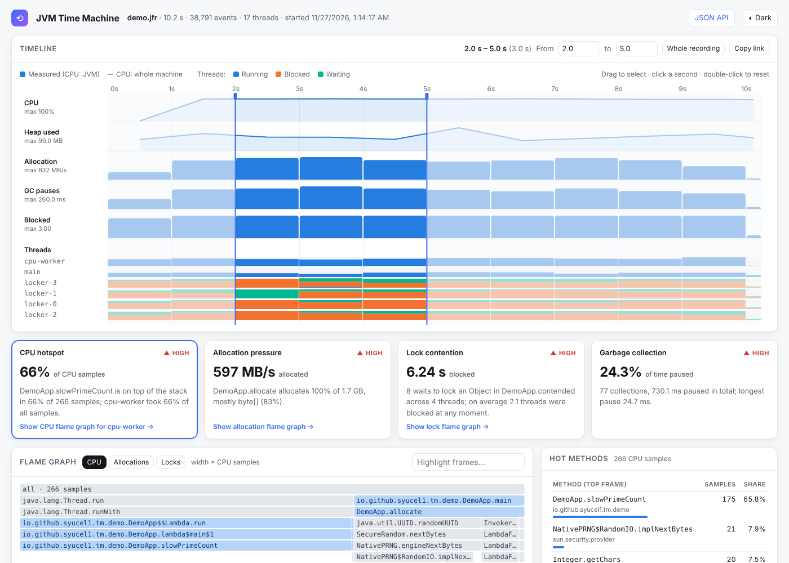

# JVM Time Machine

> Rewind a running JVM to any moment in the last 30 minutes and see exactly what it was doing.

[](https://syucel1.github.io/jvm-time-machine/DESIGN.html)
[](https://syucel1.github.io/jvm-time-machine/ROADMAP.html)
[](ROADMAP.md)
[](https://github.com/syucel1/jvm-time-machine/actions/workflows/ci.yml)

**Status:** Phase 4 (Timeline UI) done: `tm-cli serve app.jfr` opens a browser timeline with a scrubber, thread lanes,
flame graphs and plain-language findings for any `.jfr` file. Read the [design](https://syucel1.github.io/jvm-time-machine/DESIGN.html)
and [roadmap](https://syucel1.github.io/jvm-time-machine/ROADMAP.html) as web pages, or the [roadmap in Markdown](ROADMAP.md).

---

## What is it?

JVM Time Machine is a free, open-source, always-on "dashcam" for Java applications. It builds on
**JDK Flight Recorder (JFR)** and adds what JFR alone doesn't give you:

| Feature | What it means |
| --- | --- |
| **Dashcam buffer** | A rolling 30-minute recording that is frozen automatically when an incident trigger fires |
| **Timeline scrubber** | Drag across time and see threads, hot methods, heap, GC, locks and in-flight requests at any second |
| **Time diff** | "What changed between 10:00 and 10:05?" as a differential flame graph and event deltas |
| **Request reconstruction** | Paste a trace ID and see that request's CPU, lock waits, SQL calls, GC pauses and exceptions |
| **Incident reports** | A readable summary of every incident, optionally written by an LLM |

It is meant to run in **production** with a steady-state overhead of **2% CPU or less**.

## Why?

- Production incidents are usually over before anyone can attach a profiler.
- JFR records the right data but has no request view, no time diff and no automatic incident capture.
- Commercial profilers (JProfiler, YourKit) are excellent for development, but they aren't designed to run always-on in production.

## Architecture at a glance

```
┌──────────────── Target JVM ────────────────┐
│ tm-agent                                   │
│  JFR recorder · Profiler bridge ·          │
│  Snapshotter · Context capture             │
│        │                                   │
│        ▼                                   │
│  Trigger engine ─► Ring buffer ─► Shipper ─┼──► tm-collector
└────────────────────────────────────────────┘     Ingest ► Event store ► Query API
                                                            │      ▲
                                                            ▼      │
                                                         Analyzer ─┘
                                                            │
             tm-ui (browser) · tm-cli · JMC/JProfiler export · Alerts
```

| Module | Role | Status |
| --- | --- | --- |
| `tm-core` | Event model, JFR parsing, aggregation, query engine (shared) | Event model, per-second timeline, window queries, flame graphs, thread lanes |
| `tm-cli` | Opens `.jfr` files and incident bundles offline; serves the UI locally | `summary`, `window`, `serve` (UI + JSON API) |
| `tm-agent` | Java agent: continuous JFR, snapshots, triggers, ring buffer, shipper | Placeholder (Phase 6) |
| `tm-collector` | Service: ingest, Parquet/DuckDB (ClickHouse for fleets), analyzer, query API | Placeholder (Phase 8) |
| `tm-ui` | Browser UI (TypeScript, React, Canvas/WebGL): timeline, flame graphs, diffs, request view | Timeline, thread lanes, flame graphs, findings |
| `demo` | Demo app with planted problems (CPU hotspot, allocations, lock contention) | Done |

**UI choice:** a browser UI, not Swing. Smooth scrubbing over millions of events needs
GPU-backed Canvas/WebGL, and a browser UI lets you share incidents by link. `tm-cli` opens it
in a local browser tab for offline use. See the decision table in [DESIGN.html](https://syucel1.github.io/jvm-time-machine/DESIGN.html#ui).

## Build and run

Requires **JDK 21+** and **Node.js 20.19+** (for the UI). The Gradle wrapper downloads Gradle
itself, and Gradle runs `npm` to build `tm-ui` into `tm-cli`. To build without Node.js, pass
`-Pui.skip=true`; `tm-cli serve` then offers the JSON API only.

```bash
# Build everything, record demo.jfr and run all tests
./gradlew build                      # Windows: gradlew.bat build

# Record the demo app under JFR (writes demo/build/jfr/demo.jfr)
./gradlew :demo:recordDemo -Pdemo.seconds=15

# Summarise any recording
./gradlew :tm-cli:run --args="summary demo/build/jfr/demo.jfr"

# What happened between 2 s and 6 s?
./gradlew :tm-cli:run --args="window demo/build/jfr/demo.jfr --from 2 --to 6"

# Open the timeline UI (and JSON API) for a recording on http://127.0.0.1:7070/
./gradlew :tm-cli:run --args="serve demo/build/jfr/demo.jfr"
```

### Timeline UI (`tm-cli serve`)



- **Overview lanes** for JVM and machine CPU, heap used, allocation rate, GC pause time and threads
  blocked on locks, one bucket per second.
- **Thread lanes** show each thread running (CPU samples), blocked on `synchronized` or waiting
  (park, sleep, `Object.wait`) second by second. Click a thread to filter the flame graph to it.
- **Scrubber:** drag across the lanes to select a window, drag its edges to resize it, drag inside
  to move it, click a second to select just that second, double-click to go back to the whole recording.
- **Findings** explain the window in plain words: the CPU hotspot, allocation pressure, lock
  contention and GC overhead, each linked to the flame graph that shows the evidence.
- **Flame graph** (Canvas) of CPU samples, allocated bytes or time blocked on locks. Application
  frames are blue, JDK frames gray. Click to zoom, search to highlight.
- **Detail tables** for hot methods, allocations by site and class, lock contention, GC and threads.
- The window, flame graph kind and thread live in the URL (`#from=2&to=5&kind=lock&thread=locker-0`),
  so **Copy link** shares exactly what you see. Light and dark themes follow the system or the toggle.

For UI development, run `tm-cli serve` and then `npm run dev` in `tm-ui/`. Vite serves the UI on
`http://localhost:5173/` with hot reload and proxies `/api` to port 7070.

Example `window` output:

```
Window 2.0-6.0 s of demo.jfr (11,956 events, 300 CPU samples)

Hot methods
   67.00%      201  io.github.syucel1.tm.demo.DemoApp.slowPrimeCount
    9.67%       29  sun.security.provider.NativePRNG$RandomIO.implNextBytes

Allocations by site (first application frame)
  100.00%     1.6 GB  io.github.syucel1.tm.demo.DemoApp.allocate

Lock contention
      5 x  total 2960.6 ms  max 1106.7 ms  io.github.syucel1.tm.demo.DemoApp.contended  [java.lang.Object]

GC: 78 collections, 831.1 ms paused in total, longest pause 39.4 ms
```

### JSON API (`tm-cli serve`)

| Endpoint | Returns |
| --- | --- |
| `GET /api/recording` | File, start time, duration, event counts per type, thread names |
| `GET /api/overview?from=&to=` | One bucket per second: JVM and machine CPU, heap used, threads, CPU samples, bytes allocated, GC pauses, lock wait time |
| `GET /api/window?from=&to=&top=` | Hot methods, allocations by class and by application site, lock contention, GC summary, busiest threads |
| `GET /api/flamegraph?kind=&from=&to=&thread=&minPercent=` | Merged call tree for a flame graph. `kind` is `cpu` (samples), `alloc` (bytes) or `lock` (blocked nanoseconds); subtrees under `minPercent` (default 0.05) fold into their parent |
| `GET /api/threads?from=&to=&limit=` | Per-thread, per-second lanes: CPU samples, blocked and waiting nanoseconds, bytes allocated |

`from` and `to` are seconds since the recording start (both optional). `GET /api` lists the
endpoints. The server binds to `127.0.0.1` by default (use `--host` and `--port` to change it),
sends no CORS headers and, on loopback, rejects requests whose `Host` is not a loopback name, so
web pages cannot reach it through DNS rebinding.

Use the core library directly:

```java
JvmRecording rec = JfrReader.create().read(Path.of("app.jfr"));
Timeline.of(rec).buckets();                                   // per-second overview
WindowQuery.run(rec, Window.ofOffsets(rec, 2.0, 6.0), 10);    // what happened from 2 s to 6 s
HotMethods.top(rec, 10);                                      // hottest methods overall
FlameGraph.build(rec, Window.all(rec), FlameGraph.Kind.LOCK, null, 0.001); // lock waits
ThreadLanes.of(rec, Window.all(rec), 20);                     // who ran, blocked, waited each second
```

### Project layout

```
.
├── demo/            demo app with planted problems + recordDemo task
├── tm-core/         event model, JfrReader, Timeline, WindowQuery, FlameGraph, ThreadLanes, JSON writer
├── tm-cli/          command-line tool and HTTP server (summary, window, serve); bundles tm-ui
├── tm-agent/        Java agent (placeholder until Phase 6)
├── tm-collector/    collector service (placeholder until Phase 8)
├── tm-ui/           browser UI: Vite, React, TypeScript, Canvas (npm project built by Gradle)
├── docs/            screenshots
└── .github/workflows/ci.yml
```

## Try the idea today with plain JFR

JDK 17+ includes everything needed to see the kind of data we build on:

```bash
# Record
java -XX:StartFlightRecording=duration=60s,filename=app.jfr,settings=profile -jar app.jar

# Or attach to a running JVM
jcmd <pid> JFR.start duration=60s filename=app.jfr

# Analyse (JDK 21+)
jfr view hot-methods app.jfr
jfr view allocation-by-site app.jfr
jfr view contention-by-site app.jfr
jfr view gc-pauses app.jfr
jcmd <pid> JFR.view hot-methods      # live, no file
```

## Roadmap

10 phases from design to v1.0, each ending with an exit gate. Details: [ROADMAP.md](ROADMAP.md) / [ROADMAP.html](https://syucel1.github.io/jvm-time-machine/ROADMAP.html).

| # | Phase | Delivers | Status |
| --- | --- | --- | --- |
| 1 | Design | Goals, architecture, UI decision, roadmap | ✅ Done |
| 2 | Foundations | Build, CI, core event model, demo app | ✅ Done |
| 3 | Offline viewer | `tm-cli` + query API on a `.jfr` file | ✅ Done |
| 4 | Timeline UI | Browser UI with scrubber and flame graphs | ✅ Done |
| 5 | Time diff | Compare two time windows | Planned |
| 6 | Always-on agent | Agent with rolling buffer and snapshots | Planned |
| 7 | Incident capture | Triggers, incident bundles, overhead control | Planned |
| 8 | Collector & fleet | Central service, multi-JVM, alerts | Planned |
| 9 | Request context | Trace IDs, request timeline, deep profiling | Planned |
| 10 | Intelligence & v1.0 | AI summaries, hardening, packaging | Planned |

## Documents

| File | Contents |
| --- | --- |
| [DESIGN.html](https://syucel1.github.io/jvm-time-machine/DESIGN.html) ([source](DESIGN.html)) | Full design: goals, components, data model, UI decision, flows, overhead, prior art, risks |
| [ROADMAP.md](ROADMAP.md) | Phase-by-phase plan (Markdown) |
| [ROADMAP.html](https://syucel1.github.io/jvm-time-machine/ROADMAP.html) ([source](ROADMAP.html)) | Same plan, visual version |

## Requirements

- JDK 21+ to build and run (the minimum agent JDK, 17 or 21, is still an open question)
- Node.js 20.19+ to build the UI (skip with `-Pui.skip=true`)
- Any modern browser for the UI

## License

Apache License 2.0. See [LICENSE](LICENSE).
